<div align="center">


<br/>

**Find the effect you love. Copy its code. Ship it.**

<sub>افکتت رو پیدا کن، کدش رو کپی کن، تو پروژه‌ات بذار.</sub>

<br/><br/>

[**English**](#-what-is-it) · [**فارسی**](#-معرفی-به-فارسی) · [Features](#-features) · [Screenshots](#-screenshots) · [Quick start](#-quick-start) · [Add an effect](#-add-your-own-effect) · [License](#-license)



</div>

<br/>

## ✨ What is it?

**DeKo css** is a hand-crafted library of **1,053 pure-CSS effects** — buttons, loaders, cards, text, 3D, glass, backgrounds and more.
Every effect has a **live preview** you can hover and click, plus **copy-ready HTML + CSS**. No JavaScript inside the effects, no
libraries, no build step on your side: copy, paste, done.

It also ships **four live design tools** (gradient, box-shadow, border-radius and color palette) that output ready-to-paste CSS.

The site itself is bilingual (**فارسی / English**), has a **day / night theme**, and is fully responsive.

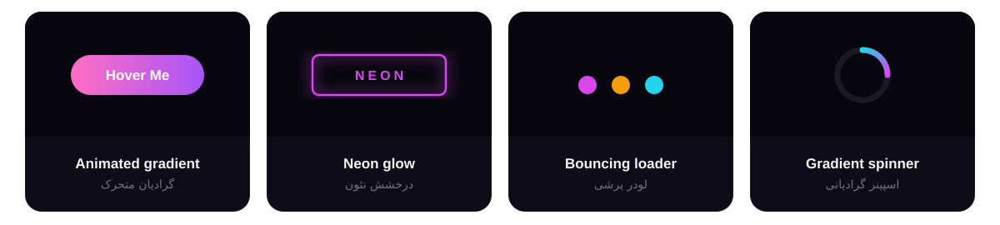

<br/>

## 🚀 Features

| | |
|---|---|
| 🎨 **1,053 effects** | 15 categories, each one scoped under its own `.fx-<id>` class so effects never collide. |
| 👀 **Live preview** | Hover or click the demo straight on the card, then open the full dialog for a bigger stage. |
| 📋 **One-click copy** | Copy the CSS from the card, or open the dialog and switch between the **HTML** and **CSS** tabs. |
| 🔍 **Instant search + filters** | Search by name or tag (`neon`, `loader`, `glass`, `سه‌بعدی`…) and filter by category with live counts. |
| 🧰 **4 design tools** | Gradient generator, box-shadow builder, border-radius builder and color palette — all with copy-ready output. |
| 🌗 **Day / night theme** | Dark by default; the choice is remembered in the browser. |
| 🌍 **Persian + English** | Every effect has a Persian and an English name and description. Persian is the default language. |
| 🧪 **Machine-validated** | A validator checks every effect for unique ids, balanced CSS, scoped selectors and keyframes, and bilingual metadata. |

<br/>

## 🗂 Categories


<br/>

## 🖼 Screenshots

<table>
<tr>
<td width="50%">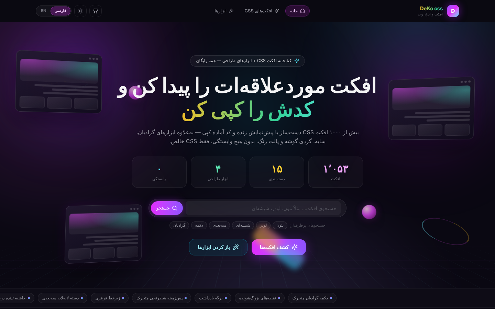<br/><sub><b>Home</b> — hero, live stats, search and the effect-name marquee.</sub></td>
<td width="50%">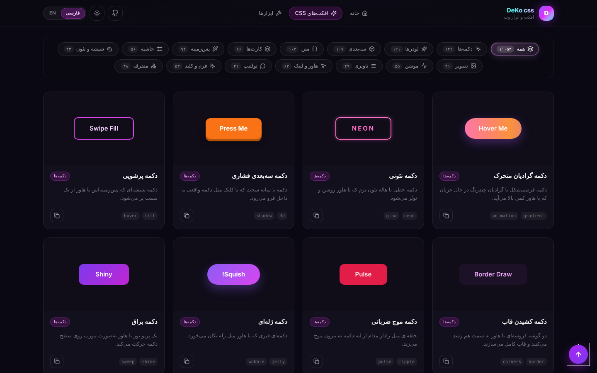<br/><sub><b>Gallery</b> — 1,053 live cards with category filters and counts.</sub></td>
</tr>
<tr>
<td width="50%">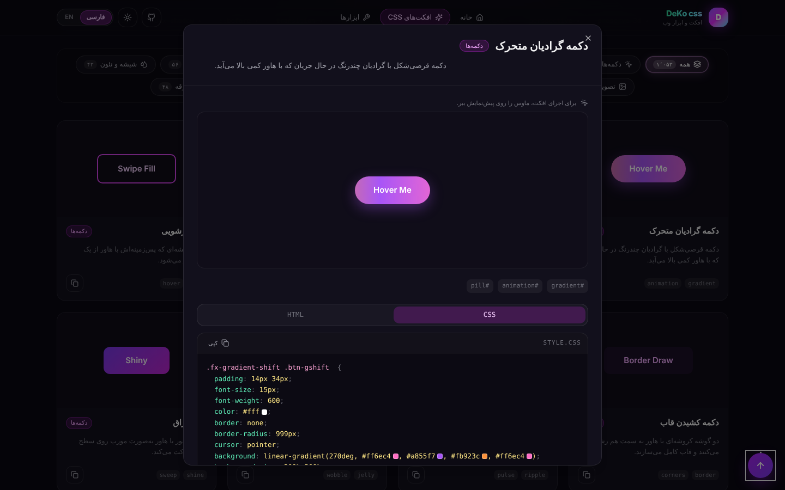<br/><sub><b>Effect dialog</b> — big preview, tags, HTML / CSS tabs, one-click copy.</sub></td>
<td width="50%">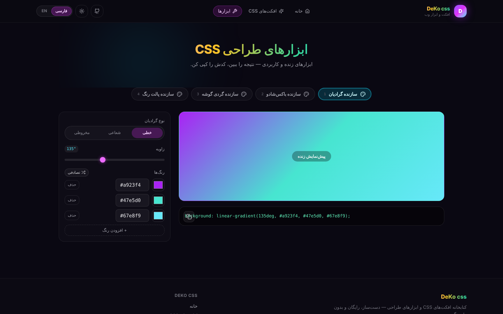<br/><sub><b>Design tools</b> — gradient, shadow, radius and palette builders.</sub></td>
</tr>
<tr>
<td colspan="2">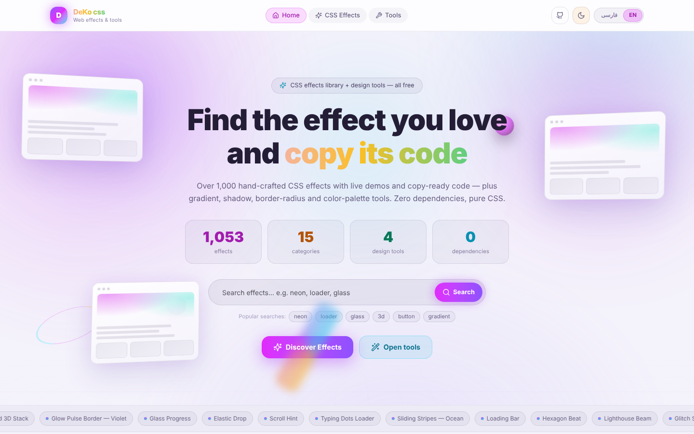<br/><sub><b>Day theme + English</b> — the header buttons switch theme and language.</sub></td>
</tr>
</table>

<br/>

## 🧰 Design tools

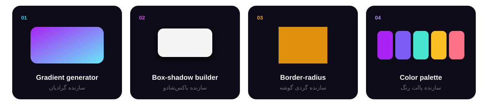

Open `/tools`, tweak the controls, and copy the generated CSS. Everything runs in the browser.

<br/>

## ⚡ Quick start

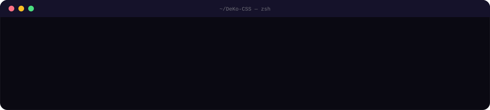

**Requirements:** Node.js 20.9+ (or [Bun](https://bun.sh)) and npm.

```bash
git clone https://github.com/amiralikarimzade8989-del/DeKo-CSS.git
cd DeKo-CSS
npm install
npm run dev
```

Then open **http://localhost:3000**.

| Script | What it does |
|---|---|
| `npm run dev` | Start the dev server on port 3000 (log is also written to `dev.log`). |
| `npm run build` | Production build (Next.js `standalone` output + static assets copied in). |
| `npm run start` | Run the production build — uses **Bun** (`bun .next/standalone/server.js`). |
| `npm run lint` | ESLint. |
| `bun scripts/check-fx.ts` | Validate **all** effects (ids, CSS balance, scoping, keyframes, bilingual text, count). |
| `bun scripts/check-plus.ts <file>` | Validate a single batch file in `src/data/fx/plus/`. |

> The UI does not need a database. A Prisma + SQLite scaffold is included (`prisma/schema.prisma`, `src/lib/db.ts`) for future use; copy `.env.example` to `.env` if you want to use it.

<br/>

## 🧩 How an effect is built

Every effect is plain data — no component code. This is the whole model (`src/data/fx/types.ts`):

```ts
export interface CssEffect {
  id: string;                 // unique kebab-case id, also the CSS scope: .fx-<id>
  name: string;               // English name
  fa?: string;                // Persian name
  category: FxCategory;       // "buttons" | "loaders" | "cards" | "text" | "backgrounds" | "hover"
                              // | "inputs" | "threed" | "borders" | "nav" | "glass" | "motion"
                              // | "tooltip" | "images" | "misc"
  description: string;
  faDescription?: string;
  tags: string[];
  html: string;               // demo markup, rendered inside <div class="fx-<id>">
  css: string;                // complete CSS, fully scoped under .fx-<id>
  previewBg?: string;         // optional preview background
  interaction?: "auto" | "hover" | "click";
}
```

<br/>

## ➕ Add your own effect

1. Create a batch file in `src/data/fx/plus/` that exports an array of `CssEffect` objects.
2. Scope **every** selector under `.fx-<id>` and give keyframes a unique prefix, so nothing leaks.
3. Validate it: `bun scripts/check-plus.ts <your-file-name-without-ext>`
4. Register the array in `src/data/fx/index.ts`.
5. Run `bun scripts/check-fx.ts` — it must finish with `OK: all effects valid`.

<br/>

## 📁 Project structure

```text
DeKo-CSS/
├── src/
│   ├── app/
│   │   ├── page.tsx            # home: hero, stats, search, marquee
│   │   ├── effects/page.tsx    # gallery: search, category filters, effect dialog
│   │   ├── tools/page.tsx      # gradient · shadow · radius · palette tools
│   │   ├── layout.tsx          # fonts (Geist, Vazirmatn), metadata, RTL default
│   │   └── globals.css         # theme tokens, day/night layer, site animations
│   ├── components/
│   │   ├── fx/                 # effect card, dialog, live preview, code block, style injector
│   │   ├── site/               # header, footer, motion helpers (reveal, tilt, count-up…)
│   │   └── ui/                 # shadcn/ui components
│   ├── data/fx/                # the 1,053 effects (+ plus/ batches) and category metadata
│   └── lib/                    # i18n (fa/en), theme store, copy helper, syntax highlighter
├── scripts/                    # check-fx.ts · check-plus.ts (effect validators)
├── prisma/schema.prisma        # optional SQLite scaffold
├── examples/websocket/         # standalone websocket example
├── public/                     # logo, robots.txt
└── assets/ · docs/screenshots/ # README images
```

<br/>

## 🛠 Tech stack


<br/>


<div dir="rtl">

## 🇮🇷 معرفی به فارسی

**DeKo css** یک کتابخانه‌ی دست‌ساز شامل **۱٬۰۵۳ افکت CSS خالص** است: دکمه، لودر، کارت، متن، سه‌بعدی، شیشه‌ای، پس‌زمینه و خیلی چیزهای دیگر.
هر افکت یک **پیش‌نمایش زنده** دارد که می‌تونی روش هاور کنی یا کلیک بزنی، و کد **HTML و CSS آماده‌ی کپی**.
داخل افکت‌ها هیچ جاوااسکریپتی نیست و به هیچ کتابخونه‌ای وابسته نیستن. کپی می‌کنی، پیست می‌کنی، تمام.

### امکانات

- **۱٬۰۵۳ افکت** در ۱۵ دسته‌بندی، هر کدوم با کلاس اختصاصی `.fx-<id>` تا با هم تداخل نکنن.
- **پیش‌نمایش زنده** روی کارت و پنجره‌ی جزئیات با تب‌های HTML و CSS.
- **کپی با یک کلیک**.
- **جستجوی فوری و فیلتر دسته‌بندی** با شمارنده‌ی هر دسته.
- **۴ ابزار طراحی**: سازنده‌ی گرادیان، باکس‌شادو، گردی گوشه و پالت رنگ.
- **حالت روز و شب** و **دو زبانه (فارسی و انگلیسی)**؛ زبان پیش‌فرض فارسیه.
- یک **اعتبارسنج خودکار** که تک‌تک افکت‌ها رو چک می‌کنه (آیدی یکتا، بالانس بودن CSS، محدوده‌ی کلاس‌ها، کی‌فریم‌ها، متن دو زبانه).

### اجرا روی سیستم خودت

```bash
git clone https://github.com/amiralikarimzade8989-del/DeKo-CSS.git
cd DeKo-CSS
npm install
npm run dev
```

بعد برو به **http://localhost:3000**.

### اضافه کردن افکت جدید

یک فایل جدید داخل `src/data/fx/plus/` بساز، همه‌ی سلکتورها رو زیر `.fx-<id>` بنویس، با دستور `bun scripts/check-plus.ts <نام-فایل>` چکش کن، توی `src/data/fx/index.ts` ثبتش کن و آخر سر `bun scripts/check-fx.ts` رو بزن. باید پیام `OK` بگیری.

</div>

<br/>

## 📜 License

Released under the **MIT License** — see [`LICENSE`](LICENSE). You can use the effects and the code in personal and commercial projects;
please keep the copyright notice.

<br/>

<div align="center">

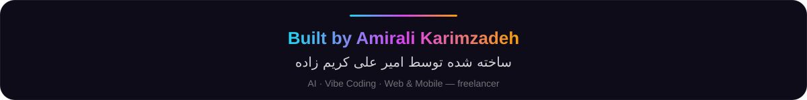

<br/>

[**GitHub**](https://github.com/amiralikarimzade8989-del) · [**Email**](mailto:amiralikarimzade8989@gmail.com) .[**link project**](https://deko-css.vercel.app/)

</div>
